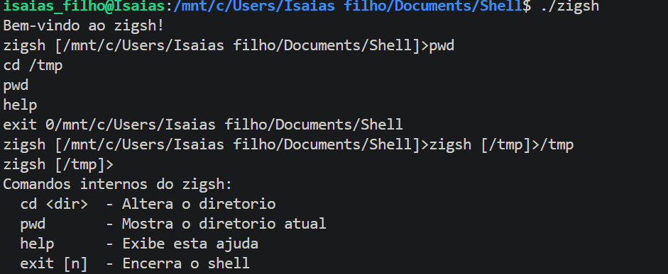
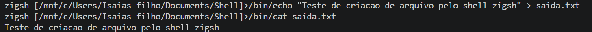
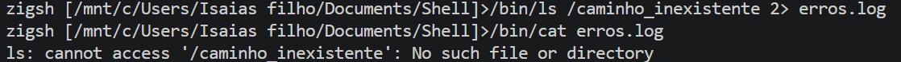
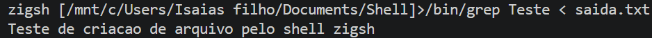
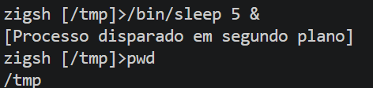
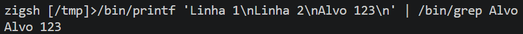
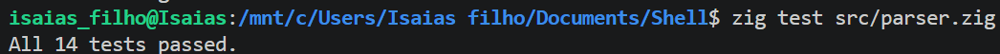

# zigsh — Shell Básico em Linux com Zig

Trabalho Prático Avaliativo — Construção de um Shell Básico em Linux (`zigsh`).

Integrantes: Isaias Maia de Oliveira e Daniel Santos Baptista.

## 1. Descrição do projeto

O **zigsh** é um interpretador de comandos (shell) minimalista, desenvolvido em **Zig 0.16.0** para sistemas Linux.

O projeto tem como objetivo aplicar conceitos fundamentais de Sistemas Operacionais, incluindo:

- Gerenciamento e criação de processos.
- Execução de comandos internos e externos.
- Processos em primeiro e segundo plano.
- Comunicação entre processos utilizando pipelines (IPC).
- Redirecionamento de entrada, saída e erros.
- Manipulação de arquivos e diretórios.

## 2. Tecnologias utilizadas

| Tecnologia | Utilização |
|---|---|
| Zig 0.16.0 | Linguagem de programação |
| Ubuntu 26.04.1 LTS | Sistema operacional Linux |
| WSL 2 | Ambiente Linux no Windows |
| Visual Studio Code | Desenvolvimento |
| Git e GitHub | Versionamento de código |

## 3. Estrutura do projeto

```text
Shell/

|── evidencias/
│   ├── teste-a.png
│   ├── teste-b.png
│   ├── teste-c.png
│   ├── teste-d.png
│   ├── teste-e.png
│   └── teste-f.png
|   └── teste-parser.png
├── src/
│   ├── main.zig
│   ├── parser.zig
│   └── executor.zig
├── tests/
│   └── test_executor.zig
├── .gitignore
└── README.md
```

A pasta `evidencias/` armazena as capturas de tela dos testes realizados no terminal Linux.

### Descrição dos arquivos

**main.zig:** responsável pelo ciclo REPL, prompt dinâmico, leitura de comandos e execução dos comandos internos.

**parser.zig:** realiza a tokenização da entrada, identificando argumentos, aspas, redirecionamentos, pipelines e execução em segundo plano.

**executor.zig:** executa comandos externos, gerencia processos filhos, redirecionamentos de arquivos e comunicação por pipes.

**test_executor.zig:** contém um programa de teste para execução de comandos externos.

## 4. Funcionalidades implementadas

### 4.1. REPL e prompt dinâmico

O shell mantém um ciclo contínuo de leitura e execução de comandos, exibindo o diretório atual.

Exemplo:

```text
zigsh [/home/usuario]>
```

O shell pode ser encerrado utilizando `exit` ou `Ctrl+D`.

### 4.2. Comandos internos

| Comando | Descrição |
|---|---|
| `cd [diretório]` | Altera o diretório atual |
| `pwd` | Exibe o diretório atual |
| `help` | Exibe os comandos disponíveis |
| `exit [código]` | Encerra o shell |

### 4.3. Comandos externos

Permite executar programas disponíveis no Linux, criando processos filhos.

Exemplos:

```bash
/bin/ls
/bin/echo Ola
/bin/date
```

### 4.4. Redirecionamento de arquivos

| Operador | Função |
|---|---|
| `>` | Redireciona a saída padrão |
| `2>` | Redireciona a saída de erros |
| `<` | Redireciona a entrada padrão |

### 4.5. Execução em segundo plano

O operador `&` permite executar processos sem bloquear imediatamente o shell.

Exemplo:

```bash
/bin/sleep 5 &
```

### 4.6. Pipelines

O operador `|` permite conectar a saída padrão de um processo à entrada padrão de outro.

Exemplo:

```bash
/bin/echo Alvo 123 | /bin/grep Alvo
```

### 4.7. Argumentos entre aspas

O parser reconhece argumentos totalmente delimitados por aspas simples ou duplas.

Exemplos:

```bash
/bin/echo "Ola mundo"
/bin/printf 'Linha 1\nLinha 2\n'
```

## 5. Compilação e execução

### Pré-requisitos

- Sistema operacional Linux.
- Compilador Zig 0.16.0.
- Biblioteca C disponível para vinculação.

Verifique a versão do compilador:

```bash
zig version
```

### Compilar o projeto

Na raiz do repositório, execute:

```bash
zig build-exe -lc \
  --dep parser --dep executor \
  -Mroot=src/main.zig \
  -Mparser=src/parser.zig \
  --dep parser -Mexecutor=src/executor.zig \
  -femit-bin=zigsh
```

### Executar o shell

```bash
./zigsh
```

## 6. Testes e evidências de execução

Os testes foram realizados em ambiente Ubuntu 26.04.1 LTS utilizando Zig 0.16.0.

As capturas de tela apresentam os comandos executados e seus respectivos resultados no terminal Linux.

### Teste A — Comandos internos

**Objetivo:** verificar o funcionamento dos comandos `pwd`, `cd`, `help` e `exit`, incluindo a atualização do diretório exibido no prompt.

**Comandos utilizados:**

```bash
pwd
cd /tmp
pwd
help
exit 0
```

**Evidência da execução:**



**Resultado:** Aprovado. Os comandos internos foram executados corretamente, com atualização do diretório de trabalho.

---

### Teste B — Redirecionamento de saída (`>`)

**Objetivo:** verificar a criação de um arquivo por meio do redirecionamento da saída padrão de um comando externo.

**Comandos utilizados:**

```bash
/bin/echo "Teste de criacao de arquivo pelo shell zigsh" > saida.txt
/bin/cat saida.txt
```

**Evidência da execução:**



**Resultado:** Aprovado. O arquivo foi criado e o conteúdo pôde ser consultado utilizando o comando `cat`.

---

### Teste C — Redirecionamento de erros (`2>`)

**Objetivo:** verificar se as mensagens de erro de um processo podem ser redirecionadas para um arquivo.

**Comandos utilizados:**

```bash
/bin/ls /caminho_inexistente 2> erros.log
/bin/cat erros.log
```

**Evidência da execução:**



**Resultado:** Aprovado. A mensagem de erro foi registrada no arquivo `erros.log` e exibida posteriormente.

---

### Teste D — Redirecionamento de entrada (`<`)

**Objetivo:** verificar a utilização de um arquivo como entrada padrão de um processo.

**Comando utilizado:**

```bash
/bin/grep Teste < saida.txt
```

**Evidência da execução:**



**Resultado:** Aprovado. O comando `grep` realizou a leitura do arquivo e encontrou o conteúdo esperado.

---

### Teste E — Execução em segundo plano (`&`)

**Objetivo:** verificar se o shell inicia um processo em segundo plano e retorna imediatamente ao prompt, permitindo a execução de novos comandos.

**Comandos utilizados:**

```bash
/bin/sleep 5 &
pwd
```

**Evidência da execução:**



**Resultado:** Aprovado. O processo foi iniciado em segundo plano, a mensagem de confirmação foi exibida e o shell continuou aceitando comandos.

---

### Teste F — Encadeamento de processos por pipeline (`|`)

**Objetivo:** verificar a comunicação entre dois processos, utilizando a saída padrão do primeiro como entrada padrão do segundo.

**Comando utilizado:**

```bash
/bin/printf 'Linha 1\nLinha 2\nAlvo 123\n' | /bin/grep Alvo
```

**Evidência da execução:**



**Resultado:** Aprovado. O pipeline conectou os processos corretamente e o comando `grep` exibiu a linha `Alvo 123`.

---

### Resumo dos testes funcionais

| Teste | Funcionalidade | Resultado |
|---|---|---|
| A | Comandos internos | Aprovado |
| B | Redirecionamento de saída (`>`) | Aprovado |
| C | Redirecionamento de erro (`2>`) | Aprovado |
| D | Redirecionamento de entrada (`<`) | Aprovado |
| E | Execução em segundo plano (`&`) | Aprovado |
| F | Pipeline (`\|`) | Aprovado |

## 7. Testes unitários do parser

O módulo `parser.zig` possui testes unitários para verificar a interpretação dos comandos e operadores.

Para executar:

```bash
zig test src/parser.zig
```

**Resultado obtido:**

```text
All 14 tests passed.
```

Os testes contemplam comandos e argumentos, redirecionamentos, background, pipelines, operadores sem espaços, rejeição de entradas inválidas e argumentos delimitados por aspas.

### Evidência dos testes unitários



**Resultado:** 14 testes aprovados.

## 8. Limitações e melhorias futuras

Embora os cenários principais tenham sido validados, algumas funcionalidades podem ser aprimoradas:

- Suporte avançado a aspas e caracteres de escape.
- Histórico de comandos.
- Gerenciamento completo de processos em segundo plano.
- Melhor tratamento de erros e sinais.
- Testes automatizados de integração.

## 9. Conclusão

O desenvolvimento do `zigsh` permitiu aplicar conceitos fundamentais de Sistemas Operacionais, especialmente criação e gerenciamento de processos, concorrência, redirecionamento de arquivos e comunicação entre processos.

O projeto foi compilado utilizando Zig 0.16.0 no Linux, com os seis testes funcionais realizados com sucesso e 14 testes unitários aprovados.
